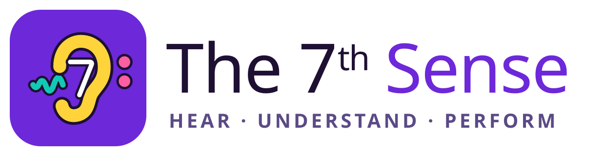

<p align="center"></p>

# The 7th Sense

*Formerly ToneTurn.* The product name changed in 0.20.0; internal identifiers (repository, `toneturn_*` database objects, storage keys, the `/toneturn/` Pages path) keep the old name so existing progress and accounts carry over.

**Brand assets** — `public/icon.svg` (app icon), `docs/brand/wordmark.svg` / `wordmark-dark.svg`, PNG icons generated by `node scripts/render-brand.mjs` (`apple-touch-icon.png`, `icon-192.png`, `icon-512.png`, `icon-maskable-512.png`). The mark is a 9 that doubles as an ear (the tail is the lobe), a note head in the bowl and sound waves coming in; colours from the app palette (gold → coral on night purple, mint accents), wordmark in Rubik.

Voice-first ear-training game: hear it, say it, sing it. Responsive web app (desktop + Android), TypeScript + React + Vite, installable as a PWA where supported. No accounts, paid APIs or cloud services.

## Run

```bash
npm install
npm run dev            # http://localhost:5173  (localhost is a secure context → mic allowed)
npm run dev:https      # https://<LAN-IP>:5173 with a self-signed cert, for Android on the same Wi-Fi
npm test               # unit + controller tests (deterministic fake adapters)
npm run test:e2e       # Playwright E2E in your installed Google Chrome (headless, fake mic device)
npm run test:all       # both
npm run build          # typecheck + production build into dist/
npm run preview        # serve dist/ (service worker active only in production builds)
```

Useful URLs

| URL | What |
| --- | --- |
| `/` | Home → **Practice** (the single Start gesture) |
| `/#/diagnostics` | **Voice check**: probes environment, audio, mic capture and speech recognition separately; copyable JSON report |
| `/?sim=1` | **Simulator**: scripted voice answers, real audio/narration. Clearly labelled, writes no progress. Not evidence that recognition works. |

> **Test voice in a standalone browser tab.** Embedded previews (attachment previews, IDE/app browser panes, iframes) often block the microphone. The Voice check shows `embedded (iframe)` and `mic permission` so the surface is recorded.

## What's in milestone 1

- Illustrated home, lesson path with next unlock, Voice/Buttons switch, XP and streak.
- Lesson **“Same B♭, two homes”**: intro comparing the same B♭4 after a B♭-major cadence (degree 1) and an E♭-major cadence (degree 5, with resolution), then 3 scored rounds answered “one”/“five” (Hebrew or English), 10 XP per first-try correct answer, replayable recap with one recommendation.
- Hands-free voice loop: prompt → cadence → target → mic opens (ready cue when capture actually starts) → grade → spoken feedback → next. Mic closed during narration and playback. Voice commands: repeat / skip / stop / explain (he + en).
- Persistent Voice/Buttons switch: cancels pending audio, narration and recognition; keeps question, attempts and score; Buttons shows controls immediately; Voice replays the prompt.
- Permission triage: capture vs recognition errors classified separately (insecure context, iframe policy, blocked site permission, OS privacy block, no device, busy device, unsupported recognizer, service denial, network, language), with browser-specific recovery steps, Retry (same question) and Switch to buttons. Denials never count as wrong answers.
- Procedural piano (no samples): stiff-string partials, two-stage decay, hammer noise, closing low-pass, room reverb, limiter. Distinct bell cues for ready / correct / wrong / complete.
- Local progress in IndexedDB, idempotent completion, review queue, local-midnight streaks. App-shell service worker.

## Lessons (path unlocks in order)

| # | Lesson | Skill | Answer |
| --- | --- | --- | --- |
| 1 | Same B♭, two homes | degrees | “one” / “five” |
| 2 | Home, third, fifth (changing keys) | degrees | “one” / “three” / “five” |
| 3 | Major or minor? | chord quality | “major” / “minor” (also “happy/sad”, מז'ור/מינור) |
| 4 | Cadence detective (V–I vs ending on V) | cadences | “resolved” / “open” (נפתר / פתוח, “not resolved”) |
| 5 | Sing home & five | sung pitch | sing; live tuner, ±35 ¢, octave-insensitive, spoken high/low feedback |
| 6 | Thirds, fifths, octaves (melodic, then harmonic) | intervals | “third” / “fifth” / “octave” (טרצה / קווינטה / אוקטבה) |
| 7 | Which note is in the bass? (C, C/E, C/G) | chords | “root” / “third” / “fifth”, or “root position / first / second inversion” |
| 8 | Notes and degrees (hear → name, name → degree, degree → name) | note naming / degrees | note names in your naming system (“B flat”, “סי במול”) or degrees |
| 9 | Sing it by name (echo a note; sing a named note after a reference) | singing | sing |
| 10 | Sing the degrees (“1 3 5” → sing them in order) | singing | sing; per-note strip, partial credit |
| 15–19 | Rhythm 4–8 (sixteenths → syncopation → triplets → 3/4 & 6/8 → swing) | rhythm reading / rhythm dictation | as R1–R3; the last dictation is *built* from rhythm blocks; tolerance follows the grid to distinguish (triplets vs eighths ≈ 1/15 beat) |
| 21 | Jazz 1: sevenths & ii–V–I | chord quality / cadences | maj7 · 7 · m7 · ø7 by ear (shell voicings); ii–V–I · V–I · I–vi–ii–V by ear; voice: “two five one”, “ii V I”, “half diminished” (en/he) |
| 22 | Songs you know | melodic memory | public-domain openings (Twinkle, Ode to Joy, Frère Jacques, Yonatan HaKatan…) with their rhythm → degrees; sing one from degrees; the title is revealed after |
| 20 | Note sequences (matrix #2 #4 #5 #6 as sequences) | note naming / scale degrees / singing | voice (Do-Re-Mi or letters, דיאז/במול) or a note-name keypad |
| 14 | Riffs & runs (name a run's scale / shape; sing runs back) | vocal agility | run-id by voice or buttons; sing-run graded per note: pitch (tolerance widens with speed), clarity (smears detected), evenness |
| 11–13 | Rhythm 1–3 (quarters/halves/rests → eighths → dotted quarter) | rhythm reading / rhythm dictation | tap or say “ta” on the metronome; pick the notation you heard, or say it (“ta ti-ti ta”, “quarter, two eighths…”, טה טי-טי) |

`?unlock=all` opens every lesson (testing). Singing uses the microphone in both modes; in Buttons mode it waits for a **Sing now** tap.

## Live

**https://yosshos.github.io/toneturn/** — deployed by GitHub Actions on every push to `main` (typecheck + unit tests + build with `BASE_PATH=/toneturn/`).

## Practice tools (0.6)

- **Find my level** — optional 9-question adaptive placement → **Skill Map** (radar: unmeasured / provisional / measured, text list, diagnosis, one recommendation, 4-week comparison).
- **Review my mistakes** — fresh items from your misses; hear your answer next to the right one.
- **Weekly puzzle** — same degree-sequence puzzle for everyone in your band; gold / silver.
- **Review with spaced repetition** (0.17) — Leitner boxes: a miss is due now; each first-try correct recall pushes it to 1 → 3 → 7 → 16 → 35 days, then it leaves the queue; an early correct answer doesn't skip a box.
- **Drone practice** (0.17) — tonic (+ fifth) drone two octaves low; live degree + cents meter; a degree counts when held in tune (±20 ¢ of equal or just intonation) for 0.8 s; fill all seven. Headphones recommended.
- **MIDI keyboard** (0.17, Settings) — Web MIDI: held keys become perfectly in-tune "sung" frames for every singing task (incl. runs); a key press answers degree / note-name questions.
- **Beat Echo calibration** — tap along to 12 clicks; the median offset corrects your device's tap delay.
- **Daily challenge** (0.11) — 5 mixed questions, the same for everyone on a calendar day; points = 500 + up to 500 for speed × streak bonus; first play counts, replays are practice; Wordle-style share card (🟩 fast, 🟨 slow, ⬜ miss — no answers).

## Duel on this device (0.11)

Two players, one phone or tablet, split screen: player 1's half is rotated to face them across the table. Same sound for both; each player's first tap counts; time runs from the end of the sound; 10 s window; standings with tie-break by total response time; rematch. Buttons only (voice can't tell two speakers apart).

## Daily leaderboard (0.13, needs sign-in)

The server grades the first daily play (answers + times; same points formula) against an answer key seeded for every day through 2028-12-31 (`npm run daily-keys > supabase/seed/daily_keys.sql`; a unit test fails if the generator and the seed drift — bump `DAILY_VERSION` and re-seed). The board shows today's player count, your rank and top %, and your friends (names are never shown to strangers). Played signed out? The result uploads the next time you open the daily screen signed in.

## Class mode (0.19, needs sign-in)

Menu → Class. A teacher creates a class (6-character code); students join explicitly and can leave. The teacher sees a roster — lessons done, XP in the last 7 days, streak, first-try accuracy per skill over 30 days, last active — and assigns path lessons with an optional due date (with a done count). Students see open assignments on Home. Server: migration 12, functions only, no table grants.

## Ghost race (0.19)

Games → Race your ghost. Your best run on a question set (kind × 5/10 rounds) is stored with its seed, answers and response times; racing it replays the same questions while the ghost answers at its recorded times. Beat it to replace it.

## Online rooms (0.12, needs sign-in)

Host creates a room (question set, 5/10/15 rounds) → 6-character code or invite link `#/online/CODE` → lobby (up to 20 players) → host starts. Every device gets the round from the server (Realtime + 1.5 s polling fallback), plays the sound itself and times the answer from the end of its own playback, so network lag doesn't count. The server holds the answer key, checks plausibility (≥ 150 ms, inside the window), computes points (same formula as the duel, with streaks) and reveals a round only when it is closed. Leaderboard with movement arrows after every round; podium at the end. If someone never answers, the host closes the round after the window; if the host disappears, anyone can continue after 20 s.

Dev only: `?fakeRooms` runs an in-page room server with two bot players (used by the E2E test).

## Menu, versions, updates

☰ on the home screen: version / build / commit and **What's new**, **Install app** (browser prompt, or iOS instructions), **Check for updates / Update now** (a new service worker waits until the player chooses; first-time activation never reloads the page), notifications, friends. The service worker is generated at build time (`src/sw-template.js`) with the version and the exact asset list. Bump `package.json` and add a `src/version.ts` changelog entry for each release (a unit test keeps them in sync).

## Friends & streak reminders (optional, needs sign-in)

Friend codes, requests, and a weekly-XP league with streak, total XP, lessons and game bests (game bests are self-reported). Daily streak reminders via Web Push, sent hourly by a Supabase Edge Function to players who have a streak and haven't practised yet. Server setup: [docs/SUPABASE_SETUP.md](docs/SUPABASE_SETUP.md) part 2.

## Cloud save (optional)

Supabase + Google sign-in. Copy `.env.example` to `.env.local` and fill `VITE_SUPABASE_URL` / `VITE_SUPABASE_PUBLISHABLE_KEY`; apply `supabase/migrations/*.sql`. Without these the app is fully local. Results sync idempotently by session id (upsert on `(user_id, session_id)`), tables are owner-only via RLS, and the database rejects implausible XP.

## Languages, note names and voices

- **English is the default**; Hebrew is fully supported (RTL, Hebrew narration, Hebrew spoken answers). Quick toggle on the home screen, fine-grained in Settings: app language, answer language and narration language are independent.
- **Note names — Auto** (default): Hebrew → דו רה מי, English → C D E. Override to Letters or Do Re Mi. Hebrew always says **דיאז / במול** (e.g. “סי במול”, or “בי במול” with letter names); “פלאט/שארפ” are accepted as answers but never produced.
- **Narration voice**: Any / ♀ Female / ♂ Male preference plus a list of the device's voices for the narration language, each labelled with its detected gender and a ▶ preview. Choices are saved per language; a missing voice falls back to the gender preference, then the best voice of that language. Which voices exist depends on the OS/browser (e.g. Windows: David/Zira, Edge online: Aria/Guy/Jenny, Hebrew: Asaf ♂ / Hila ♀ / Avri ♂).

Full spec including the addendum: [docs/SPEC.md](docs/SPEC.md).

See [docs/ARCHITECTURE.md](docs/ARCHITECTURE.md), [docs/QA.md](docs/QA.md) and [docs/STATUS.md](docs/STATUS.md).
